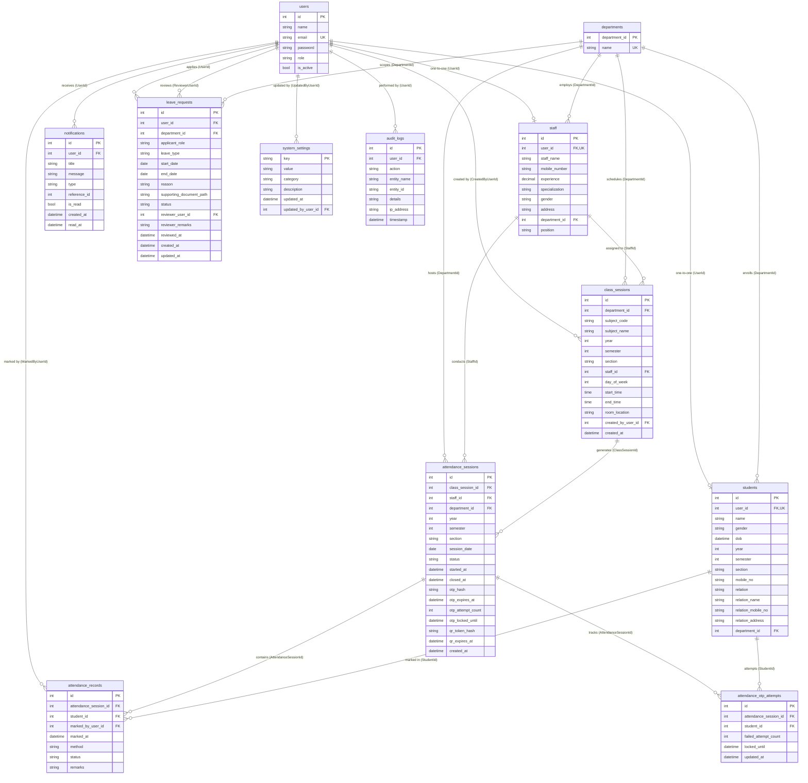

# Checkify Database Schema & Architecture

Comprehensive relational database documentation for the **Checkify Smart Attendance Management System**, powered by **MySQL 8.0** and **Entity Framework Core 10 (Code-First)**.

---

## 1. Database Architecture Overview

Checkify uses a normalized relational architecture designed to model academic institutions with role-based hierarchies (Admin, Manager, HOD, Staff, Student).

### Core Architectural Decisions:
- **Storage Engine**: InnoDB (ACID compliant, foreign keys, row-level locking).
- **Character Set & Collation**: `utf8mb4` with `utf8mb4_unicode_ci` for international name support.
- **Timestamp Standardization**: All timestamp columns are persisted and queried as **UTC**. Entity Framework Core value converters (`utcDateTimeConverter` and `nullableUtcDateTimeConverter`) ensure `DateTimeKind.Utc` is preserved upon hydration.
- **Referential Integrity**: Delete behaviors default to `DeleteBehavior.Restrict` across all institutional records (Students, Staff, Sessions, Records, Settings, Audit Logs) to prevent accidental cascade deletion of historical records. The only exception is `Notification`, which cascades on `User` deletion (`DeleteBehavior.Cascade`).
- **Composite Indexes**: Optimized multi-column indexes support high-traffic query patterns including timetable lookups, active attendance tracking, student history queries, defaulter thresholds, and audit log inspection.

---

## 2. Entity-Relationship (ER) Diagram

---

## 3. Entity & Table Specifications

### 3.1 `users`
Central identity store for all system actors.

| Column | Data Type | Nullable | Constraints | Description |
|---|---|---|---|---|
| `Id` | `INT` | No | PK, Auto Increment | Unique user identifier |
| `Name` | `LONGTEXT` / `VARCHAR(255)` | No | | Full legal or display name |
| `Email` | `VARCHAR(255)` | No | Unique (`IX_users_Email`) | System login username |
| `Password` | `LONGTEXT` | No | | BCrypt hash (Work factor 12) |
| `Role` | `LONGTEXT` | No | | `ADMIN`, `MANAGER`, `HOD`, `STAFF`, `STUDENT` |
| `IsActive` | `TINYINT(1)` | No | Default `1` | Account activation flag |

---

### 3.2 `departments`
Academic departments (e.g., Computer Science, Mechanical Engineering).

| Column | Data Type | Nullable | Constraints | Description |
|---|---|---|---|---|
| `department_id` | `INT` | No | PK, Auto Increment | Department ID |
| `Name` | `VARCHAR(255)` | No | Unique (`IX_departments_name`) | Unique department title |

---

### 3.3 `students`
Student profile linking an institutional identity to academic cohort details.

| Column | Data Type | Nullable | Constraints | Description |
|---|---|---|---|---|
| `Id` | `INT` | No | PK, Auto Increment | Student primary key |
| `UserId` | `INT` | No | FK (`users.Id`), Unique | Associated user account |
| `Name` | `LONGTEXT` | No | | Student full name |
| `Gender` | `LONGTEXT` | No | | `Male`, `Female`, `Other` |
| `Dob` | `DATETIME` | No | | Date of birth (UTC) |
| `Year` | `INT` | No | | Academic year (1, 2, 3, 4) |
| `Semester` | `INT` | No | | Academic semester (1-8) |
| `Section` | `LONGTEXT` | No | | Section identifier (`A`, `B`, `C`) |
| `MobileNo` | `LONGTEXT` | No | | Student phone number |
| `Relation` | `LONGTEXT` | Yes | | Parent/Guardian relationship |
| `RelationName` | `LONGTEXT` | Yes | | Guardian full name |
| `RelationMobileNo` | `LONGTEXT` | Yes | | Guardian contact number |
| `RelationAddress` | `LONGTEXT` | Yes | | Residential address |
| `DepartmentId` | `INT` | No | FK (`departments.department_id`) | Enrolled department |

---

### 3.4 `staff`
Faculty and managerial staff profile.

| Column | Data Type | Nullable | Constraints | Description |
|---|---|---|---|---|
| `Id` | `INT` | No | PK, Auto Increment | Staff primary key |
| `UserId` | `INT` | No | FK (`users.Id`), Unique | Associated user account |
| `StaffName` | `LONGTEXT` | No | | Staff full name |
| `MobileNumber` | `LONGTEXT` | No | | Contact number |
| `Experience` | `DECIMAL(18,2)` | No | | Years of experience |
| `Specialization` | `LONGTEXT` | Yes | | Subject specialization |
| `Gender` | `LONGTEXT` | No | | `Male`, `Female`, `Other` |
| `Address` | `LONGTEXT` | Yes | | Residential address |
| `DepartmentId` | `INT` | No | FK (`departments.department_id`) | Assigned department |
| `Position` | `LONGTEXT` | No | | Position title (e.g., `Assistant Professor`, `HOD`) |

---

### 3.5 `class_sessions`
Scheduled timetable definitions.

| Column | Data Type | Nullable | Constraints | Description |
|---|---|---|---|---|
| `Id` | `INT` | No | PK, Auto Increment | Class schedule session ID |
| `DepartmentId` | `INT` | No | FK (`departments.department_id`) | Department offering class |
| `SubjectCode` | `LONGTEXT` | No | | Course code (e.g., `CS301`) |
| `SubjectName` | `LONGTEXT` | No | | Full course title |
| `Year` | `INT` | No | | Target academic year |
| `Semester` | `INT` | No | | Target academic semester |
| `Section` | `LONGTEXT` | No | | Target section |
| `StaffId` | `INT` | No | FK (`staff.Id`) | Instructor assigned |
| `DayOfWeek` | `INT` | No | Enum (0=Sun, 1=Mon, ..., 6=Sat) | Scheduled day of the week |
| `StartTime` | `TIME` | No | TimeOfDay converter | Class commencement time |
| `EndTime` | `TIME` | No | TimeOfDay converter | Class conclusion time |
| `RoomLocation` | `LONGTEXT` | Yes | | Room or lab number |
| `CreatedByUserId` | `INT` | No | FK (`users.Id`) | User who created schedule |
| `CreatedAt` | `DATETIME` | No | UTC Default | Timestamp of creation |

---

### 3.6 `attendance_sessions`
Live or completed attendance periods created by instructors.

| Column | Data Type | Nullable | Constraints | Description |
|---|---|---|---|---|
| `Id` | `INT` | No | PK, Auto Increment | Session primary key |
| `ClassSessionId` | `INT` | No | FK (`class_sessions.Id`) | Originating timetable slot |
| `StaffId` | `INT` | No | FK (`staff.Id`) | Instructor conducting session |
| `DepartmentId` | `INT` | No | FK (`departments.department_id`) | Department context |
| `Year` | `INT` | No | | Student cohort year |
| `Semester` | `INT` | No | | Student cohort semester |
| `Section` | `LONGTEXT` | No | | Student cohort section |
| `SessionDate` | `DATE` | No | DateOnly converter | Calendar date of class |
| `Status` | `LONGTEXT` | No | Default `'OPEN'` | `OPEN`, `CLOSED`, `EXPIRED`, `CANCELLED` |
| `StartedAt` | `DATETIME` | No | UTC | Opening timestamp |
| `ClosedAt` | `DATETIME` | Yes | UTC | Closing timestamp |
| `OtpHash` | `LONGTEXT` | Yes | | SHA-256 hash of active 6-digit OTP |
| `OtpExpiresAt` | `DATETIME` | Yes | UTC | OTP expiration time (typically 30-60s) |
| `OtpAttemptCount` | `INT` | No | Default `0` | Global session OTP attempts |
| `OtpLockedUntil` | `DATETIME` | Yes | UTC | Session-level brute-force lock |
| `QrTokenHash` | `LONGTEXT` | Yes | | SHA-256 hash of active dynamic QR payload |
| `QrExpiresAt` | `DATETIME` | Yes | UTC | Dynamic QR expiration time (15s rotation) |
| `CreatedAt` | `DATETIME` | No | UTC Default | Session creation timestamp |

---

### 3.7 `attendance_records`
Individual student attendance log entries.

| Column | Data Type | Nullable | Constraints | Description |
|---|---|---|---|---|
| `Id` | `INT` | No | PK, Auto Increment | Record primary key |
| `AttendanceSessionId` | `INT` | No | FK (`attendance_sessions.Id`) | Session reference |
| `StudentId` | `INT` | No | FK (`students.Id`) | Student reference |
| `MarkedByUserId` | `INT` | Yes | FK (`users.Id`) | User who recorded entry (student or staff) |
| `MarkedAt` | `DATETIME` | No | UTC Default | Timestamp recorded |
| `Method` | `LONGTEXT` | No | | `OTP`, `QR`, `STAFF_MANUAL`, `SYSTEM` |
| `Status` | `LONGTEXT` | No | | `PRESENT`, `ABSENT`, `LATE`, `EXCUSED` |
| `Remarks` | `LONGTEXT` | Yes | | Excusal reason or staff notes |

---

### 3.8 `attendance_otp_attempts`
Brute-force protection tracking per student per session.

| Column | Data Type | Nullable | Constraints | Description |
|---|---|---|---|---|
| `Id` | `INT` | No | PK, Auto Increment | Tracking ID |
| `AttendanceSessionId` | `INT` | No | FK (`attendance_sessions.Id`) | Target session |
| `StudentId` | `INT` | No | FK (`students.Id`) | Submitting student |
| `FailedAttemptCount` | `INT` | No | Default `0` | Number of failed OTP guesses |
| `LockedUntil` | `DATETIME` | Yes | UTC | Student lockout expiration time |
| `UpdatedAt` | `DATETIME` | No | UTC Default | Last attempt timestamp |

---

### 3.9 `notifications`
In-app notification messages and alerts.

| Column | Data Type | Nullable | Constraints | Description |
|---|---|---|---|---|
| `Id` | `INT` | No | PK, Auto Increment | Notification primary key |
| `UserId` | `INT` | No | FK (`users.Id`), Cascade | Recipient user ID |
| `Title` | `LONGTEXT` | No | | Short notification title |
| `Message` | `LONGTEXT` | No | | Detailed message body |
| `Type` | `LONGTEXT` | No | Default `'SYSTEM'` | `ATTENDANCE_WARNING`, `LEAVE_STATUS`, `SESSION_ALERT`, `SYSTEM` |
| `ReferenceId` | `INT` | Yes | | Associated entity ID (e.g., Leave ID) |
| `IsRead` | `TINYINT(1)` | No | Default `0` | Read flag |
| `CreatedAt` | `DATETIME` | No | UTC Default | Time notification was generated |
| `ReadAt` | `DATETIME` | Yes | UTC | Time notification was read |

---

### 3.10 `leave_requests`
Formal student and staff absence requests with approval workflows.

| Column | Data Type | Nullable | Constraints | Description |
|---|---|---|---|---|
| `Id` | `INT` | No | PK, Auto Increment | Leave application primary key |
| `UserId` | `INT` | No | FK (`users.Id`) | Applicant user ID |
| `DepartmentId` | `INT` | No | FK (`departments.department_id`) | Department context |
| `ApplicantRole` | `LONGTEXT` | No | Default `'STUDENT'` | `STUDENT`, `STAFF`, `HOD` |
| `LeaveType` | `LONGTEXT` | No | Default `'CASUAL'` | `CASUAL`, `MEDICAL`, `ON_DUTY`, `OTHER` |
| `StartDate` | `DATE` | No | DateOnly converter | First date of leave period |
| `EndDate` | `DATE` | No | DateOnly converter | Final date of leave period |
| `Reason` | `LONGTEXT` | No | | Reason provided by applicant |
| `SupportingDocumentPath` | `LONGTEXT` | Yes | | Uploaded medical certificate/letter path |
| `Status` | `LONGTEXT` | No | Default `'PENDING'` | `PENDING`, `APPROVED`, `REJECTED`, `CANCELLED` |
| `ReviewerUserId` | `INT` | Yes | FK (`users.Id`) | Reviewing authority (HOD/Manager) |
| `ReviewerRemarks` | `LONGTEXT` | Yes | | Feedback or justification from reviewer |
| `ReviewedAt` | `DATETIME` | Yes | UTC | Timestamp of review |
| `CreatedAt` | `DATETIME` | No | UTC Default | Application submission timestamp |
| `UpdatedAt` | `DATETIME` | Yes | UTC | Modification timestamp |

---

### 3.11 `system_settings`
Global institutional configuration key-value store.

| Column | Data Type | Nullable | Constraints | Description |
|---|---|---|---|---|
| `Key` | `VARCHAR(255)` | No | PK | Configuration key name |
| `Value` | `LONGTEXT` | No | | Configuration value |
| `Category` | `VARCHAR(255)` | No | Default `'GENERAL'` | `GENERAL`, `ACADEMIC`, `ATTENDANCE`, `SECURITY` |
| `Description` | `LONGTEXT` | Yes | | Human-readable explanation of setting |
| `UpdatedAt` | `DATETIME` | No | UTC Default | Timestamp of last modification |
| `UpdatedByUserId` | `INT` | Yes | FK (`users.Id`) | Admin who updated setting |

---

### 3.12 `audit_logs`
Immutable compliance and security event trail.

| Column | Data Type | Nullable | Constraints | Description |
|---|---|---|---|---|
| `Id` | `INT` | No | PK, Auto Increment | Audit record primary key |
| `UserId` | `INT` | Yes | FK (`users.Id`) | Actor ID (null for system actions) |
| `Action` | `VARCHAR(255)` | No | | `USER_LOGIN`, `ROLE_UPDATED`, `PASSWORD_RESET`, `SETTING_UPDATED`, `LEAVE_REVIEWED`, etc. |
| `EntityName` | `VARCHAR(255)` | No | | Affected domain entity (`User`, `LeaveRequest`, `SystemSetting`, etc.) |
| `EntityId` | `LONGTEXT` | Yes | | Affected entity's primary key |
| `Details` | `LONGTEXT` | No | | Detailed context or change diff |
| `IpAddress` | `LONGTEXT` | Yes | | Client remote IP address |
| `Timestamp` | `DATETIME` | No | UTC Default | Exact event timestamp |

---

## 4. Referential Integrity & Foreign Key Policies

| Foreign Key Constraint | Parent Table | Child Table | On Delete Rule | Rationale |
|---|---|---|---|---|
| `FK_students_users_UserId` | `users` | `students` | `RESTRICT` | Preserve historical academic records even if user state changes |
| `FK_students_departments_DepartmentId` | `departments` | `students` | `RESTRICT` | Prevent department deletion while enrolled students exist |
| `FK_staff_users_UserId` | `users` | `staff` | `RESTRICT` | Preserve faculty work history and session records |
| `FK_staff_departments_DepartmentId` | `departments` | `staff` | `RESTRICT` | Prevent department deletion while faculty are assigned |
| `FK_class_sessions_departments_DepartmentId` | `departments` | `class_sessions` | `RESTRICT` | Preserve timetable definitions |
| `FK_class_sessions_staff_StaffId` | `staff` | `class_sessions` | `RESTRICT` | Prevent staff deletion while active class assignments exist |
| `FK_class_sessions_users_CreatedByUserId` | `users` | `class_sessions` | `RESTRICT` | Retain audit traceability for timetable creation |
| `FK_attendance_sessions_class_sessions_ClassSessionId` | `class_sessions` | `attendance_sessions` | `RESTRICT` | Attendance history cannot exist without schedule context |
| `FK_attendance_sessions_staff_StaffId` | `staff` | `attendance_sessions` | `RESTRICT` | Retain session conductor history |
| `FK_attendance_sessions_departments_DepartmentId` | `departments` | `attendance_sessions` | `RESTRICT` | Retain department attendance metrics |
| `FK_attendance_records_attendance_sessions_AttendanceSessionId` | `attendance_sessions` | `attendance_records` | `RESTRICT` | Records must strictly bind to their attendance session |
| `FK_attendance_records_students_StudentId` | `students` | `attendance_records` | `RESTRICT` | Retain individual student attendance history |
| `FK_attendance_records_users_MarkedByUserId` | `users` | `attendance_records` | `RESTRICT` | Retain marker attribution |
| `FK_attendance_otp_attempts_attendance_sessions_AttendanceSessionId` | `attendance_sessions` | `attendance_otp_attempts` | `RESTRICT` | Track brute-force attempts per session |
| `FK_attendance_otp_attempts_students_StudentId` | `students` | `attendance_otp_attempts` | `RESTRICT` | Track brute-force attempts per student |
| `FK_notifications_users_UserId` | `users` | `notifications` | `CASCADE` | User-scoped notification inbox purges if user is purged |
| `FK_leave_requests_users_UserId` | `users` | `leave_requests` | `RESTRICT` | Retain official leave records |
| `FK_leave_requests_departments_DepartmentId` | `departments` | `leave_requests` | `RESTRICT` | Retain department leave records |
| `FK_leave_requests_users_ReviewerUserId` | `users` | `leave_requests` | `RESTRICT` | Retain reviewer signatures |
| `FK_system_settings_users_UpdatedByUserId` | `users` | `system_settings` | `RESTRICT` | Retain administrative update attribution |
| `FK_audit_logs_users_UserId` | `users` | `audit_logs` | `RESTRICT` | Immutable audit logs must retain actor references |

---

## 5. Index Catalog & Performance Targets

| Table | Index Name | Columns | Type | Target Workload / Query Pattern |
|---|---|---|---|---|
| `users` | `IX_users_Email` | `Email` | Unique | User authentication and duplicate email checks |
| `departments` | `IX_departments_name` | `Name` | Unique | Department duplicate prevention |
| `students` | `IX_students_UserId` | `UserId` | Unique | 1:1 user-to-student profile resolution |
| `staff` | `IX_staff_UserId` | `UserId` | Unique | 1:1 user-to-staff profile resolution |
| `class_sessions` | `IX_class_sessions_student_timetable` | `DepartmentId, Year, Section, DayOfWeek` | Composite | Instant student weekly timetable rendering |
| `class_sessions` | `IX_class_sessions_staff_day` | `StaffId, DayOfWeek` | Composite | Faculty schedule rendering and schedule clash prevention |
| `attendance_sessions` | `IX_attendance_sessions_class_date` | `ClassSessionId, SessionDate` | Unique Composite | Enforces max 1 attendance session per class per date |
| `attendance_sessions` | `IX_attendance_sessions_staff_date` | `StaffId, SessionDate` | Composite | Faculty daily session history |
| `attendance_sessions` | `IX_attendance_sessions_cohort` | `DepartmentId, Year, Semester, Section` | Composite | Student active session discovery |
| `attendance_records` | `IX_attendance_records_session_student` | `AttendanceSessionId, StudentId` | Unique Composite | Prevents double-marking attendance in single session |
| `attendance_records` | `IX_attendance_records_student_date` | `StudentId, MarkedAt` | Composite | Student attendance percentage & trends computation |
| `attendance_otp_attempts` | `IX_attendance_otp_attempts_session_student` | `AttendanceSessionId, StudentId` | Unique Composite | Instant OTP attempt increment & lockout check |
| `attendance_otp_attempts` | `IX_attendance_otp_attempts_student` | `StudentId` | Index | Student-wide attempt auditing |
| `notifications` | `IX_notifications_user_read_created` | `UserId, IsRead, CreatedAt` | Composite | Instant unread count badge & chronological inbox fetch |
| `leave_requests` | `IX_leave_requests_user_dates` | `UserId, StartDate, EndDate` | Composite | Overlapping leave application prevention |
| `leave_requests` | `IX_leave_requests_dept_status` | `DepartmentId, Status, CreatedAt` | Composite | HOD pending leaves queue |
| `leave_requests` | `IX_leave_requests_status` | `Status, CreatedAt` | Composite | Institutional leave dashboard queries |
| `system_settings` | `IX_system_settings_category` | `Category` | Index | Category-filtered settings queries |
| `audit_logs` | `IX_audit_logs_entity_timestamp` | `EntityName, Timestamp` | Composite | Entity-specific audit inspection |
| `audit_logs` | `IX_audit_logs_user_timestamp` | `UserId, Timestamp` | Composite | User activity compliance monitoring |
| `audit_logs` | `IX_audit_logs_action_timestamp` | `Action, Timestamp` | Composite | Security event filtering (e.g., login failures) |

---

## 6. Migration History

| Migration Identifier | Date Applied | Summary of Changes |
|---|---|---|
| `20261104064735_InitialCreate` | 2026-11-04 | Created base `users` and `departments` tables with foreign keys |
| `20261104074901_AddDepartmentNameUniqueIndex` | 2026-11-04 | Added unique index `IX_departments_name` to prevent duplicate department names |
| `20261104095700_AddStudentAndStaffEntities` | 2026-11-04 | Introduced `students` and `staff` profile entities with 1:1 user bindings |
| `20261105043143_AddClassSessions` | 2026-11-05 | Created `class_sessions` timetable table with clash detection indexes |
| `20261105052353_AddSemesterAndSectionToStudent` | 2026-11-05 | Added `Semester` and `Section` columns to `students` for cohort alignment |
| `20261105091045_AddAttendanceEntities` | 2026-11-05 | Created `attendance_sessions` and `attendance_records` tables with OTP/QR fields |
| `20261105094002_AddAttendanceOtpAttempts` | 2026-11-05 | Created `attendance_otp_attempts` table to enforce per-session brute force rate limits |
| `20261106052507_AddNotifications` | 2026-11-06 | Created `notifications` table for real-time institutional communications |
| `20261106085616_AddLeaveManagement` | 2026-11-06 | Created `leave_requests` table with automated attendance excusal integration |
| `20261110052323_AddAdminAndAuditSystem` | 2026-11-10 | Created `system_settings` and `audit_logs` tables with administrative controls |

